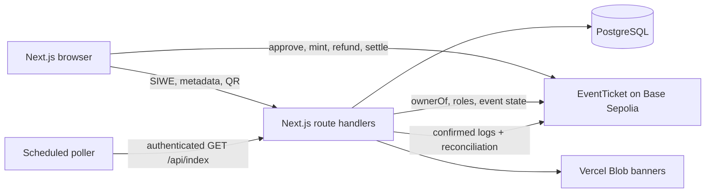

# Architecture



## Trust boundaries

- The contract owns payment and NFT state. The application never creates a confirmed purchase from a pending wallet transaction.
- PostgreSQL stores event metadata, SIWE sessions, staff permissions, QR nonces, check-ins, and a synchronized event index. Check-in state is intentionally offchain.
- Wallet connection alone grants no server permission. Every protected API checks a server session and role. Organizer access requires the database approval and a wallet role for chain writes.
- Indexer entries use chain ID, transaction hash, and log index as unique keys. Block numbers and hashes support checkpoint replay and reorg rollback. Eight confirmations precede indexing. The indexer compares indexed sales and refunds to onchain accounting at the indexed block.
- Indexing processes 64 blocks per request and resumes from the database checkpoint. A separate worker or scheduler calls `/api/index`; see deployment guidance. API failures leave the previous checkpoint for retry. The indexer halts if an onchain event has no matching organizer draft or accounting diverges.

## Data flow

```mermaid
sequenceDiagram
  participant Buyer
  participant USDC
  participant Ticket as EventTicket
  participant Indexer
  participant DB as PostgreSQL
  Buyer->>USDC: approve exact allowance when needed
  Buyer->>Ticket: purchase(eventId)
  Ticket->>USDC: safeTransferFrom(price)
  Ticket-->>Buyer: mint ERC-721
  Ticket-->>Indexer: TicketPurchased log
  Indexer->>Ticket: wait 8 confirmations; reconcile state
  Indexer->>DB: idempotent purchase and ticket records
```

## Main tables

`User`, `WalletAccount`, `AuthNonce`, `Session`, `OrganizerProfile`, `Event`, `TicketType`, `Purchase`, `Ticket`, `StaffPermission`, `QrCredential`, `CheckIn`, `TransactionRecord`, `IndexedLog`, `IndexedBlock`, `SyncCheckpoint`, `AuditLog`, and `RateLimitBucket`. See `apps/web/prisma/schema.prisma` and its SQL migration for constraints and indexes.

## Economics

All token amounts are integer six-decimal units. A 25 USDC ticket is `25000000`; the fee is `price * 200 / 10000`. Escrow liability is the sum of refundable canceled purchases plus unsettled organizer proceeds and platform fees. Canceled events can never settle; each original buyer can claim once and receives the full price. Nontransferable tickets keep the original buyer equal to the owner until a refund burns the NFT.
